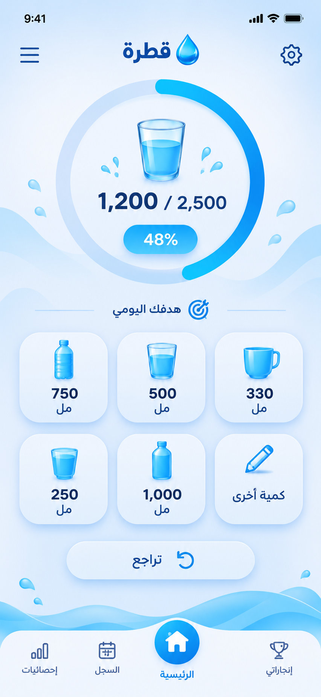

# قطرة — Qatra

تطبيق أندرويد عربي لتسجيل كمية الماء اليومية، مع ويدجت مرتبطة بالتطبيق تلقائيًا.



## ما الذي يعمل في النسخة 1.0؟

- شاشة رئيسية عربية باتجاه RTL.
- قطرة متحركة يرتفع الماء داخلها حسب نسبة الإنجاز.
- ستة أزرار إضافة سريعة: 150، 250، 330، 500، 750، و1000 مل.
- إدخال كمية مخصصة حتى 5000 مل.
- التراجع عن آخر عملية إضافة.
- هدف يومي قابل للتغيير، والهدف الافتراضي 2500 مل.
- سجل محلي لآخر 14 يومًا.
- إحصائيات آخر سبعة أيام: المتوسط، الإجمالي، أيام تحقيق الهدف، وسلسلة الإنجاز.
- رسم بياني أسبوعي خفيف دون مكتبات خارجية.
- تذكيرات اختيارية كل 1–6 ساعات ضمن وقت بداية ونهاية يحدده المستخدم.
- ويدجت متوسطة تعرض مستوى القطرة والكمية والنسبة.
- أزرار +250 مل و+500 مل والتراجع داخل الويدجت.
- مزامنة فورية: أي إضافة من التطبيق تحدث الويدجت، وأي إضافة من الويدجت تظهر في التطبيق.
- بداية يوم جديد تلقائيًا مع الاحتفاظ بسجل الأيام السابقة.
- لا يحتاج التطبيق إلى حساب، ولا يرسل بيانات إلى الإنترنت.

## مصدر البيانات الواحد

يستخدم التطبيق والويدجت مخزنًا محليًا مشتركًا باسم `QatraStore`. بعد كل إضافة أو تراجع أو تغيير للهدف:

1. تُحفظ العملية على الهاتف.
2. يُعاد حساب مجموع اليوم.
3. تتحدث شاشة التطبيق.
4. تُعاد صناعة صورة القطرة بنسبة الامتلاء الجديدة.
5. تتحدث جميع نسخ الويدجت الموجودة على الشاشة الرئيسية.

## بناء APK من المتصفح دون Android Studio

المشروع يتضمن مسار GitHub Actions جاهزًا في:

```text
.github/workflows/build-apk.yml
```

طريقة البناء السحابي:

1. أنشئ مستودعًا فارغًا في GitHub من المتصفح.
2. ارفع **محتويات** مجلد المشروع مع المحافظة على المجلدات، بما فيها المجلد المخفي `.github`.
3. افتح تبويب **Actions**.
4. اختر **Build Qatra APK** ثم **Run workflow**.
5. بعد نجاح العملية، افتح آخر تشغيل ونزّل الملف **Qatra-APK** من قسم Artifacts.
6. فك الملف المضغوط وثبّت `app-debug.apk` على هاتف أندرويد.

ملف Debug الناتج يكون موقّعًا تلقائيًا وقابلًا للتثبيت المباشر. للنشر في Google Play يجب إنشاء مفتاح إصدار خاص والمحافظة عليه بأمان.

## إضافة الويدجت على الهاتف

بعد تثبيت التطبيق وفتحه مرة واحدة:

1. اضغط مطولًا على مكان فارغ في الشاشة الرئيسية.
2. اختر **الأدوات** أو **Widgets**.
3. ابحث عن **قطرة**.
4. اسحب الويدجت إلى الشاشة.

يمكن تغيير حجمها أفقيًا وعموديًا حسب دعم مشغّل الهاتف.

## الخصوصية

كل السجل والهدف والإعدادات محفوظة محليًا داخل مساحة التطبيق. لا توجد صلاحية إنترنت في `AndroidManifest.xml`، ولا توجد تحليلات أو إعلانات أو تسجيل دخول.

## بنية المشروع

```text
app/src/main/java/com/qatra/water/
├── MainActivity.java             # الواجهات والتنقل والإعدادات
├── DropProgressView.java         # قطرة التطبيق المتحركة
├── QatraStore.java               # التخزين والحسابات والسجل
├── QatraWidgetProvider.java      # الويدجت والأزرار والمزامنة
├── WidgetBitmap.java             # رسم قطرة الويدجت حسب النسبة
├── WidgetActionReceiver.java     # أزرار الويدجت الخاصة والآمنة
├── WeeklyChartView.java          # الرسم البياني الأسبوعي
├── ReminderScheduler.java        # جدولة التذكيرات
├── ReminderReceiver.java         # إنشاء الإشعارات
└── SystemEventReceiver.java      # تحديثات التاريخ وإعادة التشغيل
```

## متطلبات البناء

- Android Gradle Plugin 9.5.1
- Gradle 9.6
- Java 17
- Android SDK 36 وBuild Tools 36.0.0
- الحد الأدنى: Android 8.0، API 26

## ملاحظات الإصدار الأول

هذه نسخة أولى وظيفية ومعدة للاختبار. قبل نشرها للعامة يوصى باختبارها على عدة هواتف ومشغلات شاشة، ومراجعة صياغة إخلاء المسؤولية الصحية وسياسة الخصوصية ومتطلبات متجر Google Play.
